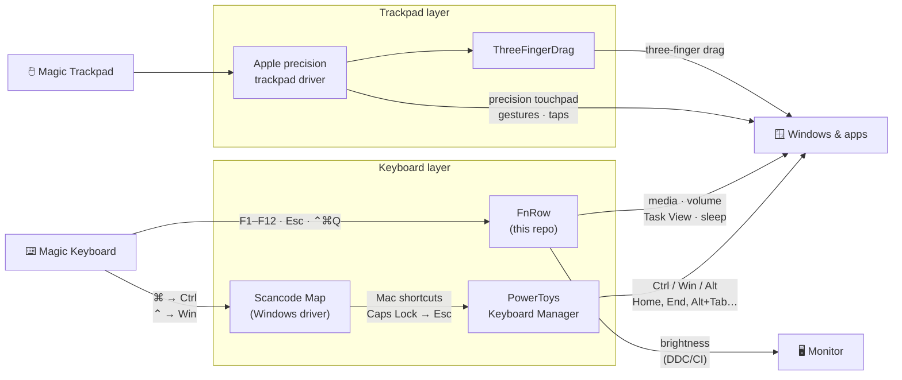

<div align="center">

# ⌘ Magic Keyboard for Windows

**Make an Apple Magic Keyboard and Magic Trackpad on Windows feel like they do on a Mac.**

<kbd>⌘</kbd> for app shortcuts · Mac text navigation · a top row that does what its icons say · three-finger drag


</div>

---

## ✨ Highlights

- **Mac modifier layout.** <kbd>⌘</kbd> works as Ctrl, so <kbd>⌘</kbd> <kbd>C</kbd>, <kbd>⌘</kbd> <kbd>Tab</kbd> and <kbd>⌘</kbd> <kbd>Q</kbd> do what you expect.
- **Mac text navigation.** <kbd>⌘</kbd> <kbd>←</kbd> jumps to the start of the line, <kbd>⌥</kbd> <kbd>←</kbd> jumps by word, <kbd>⌥</kbd> <kbd>⌫</kbd> deletes a word.
- **A top row that matches its icons.** Brightness (real monitor brightness over DDC/CI), Task View, search, dictation, media and volume. <kbd>Esc</kbd> switches to plain F1–F12.
- **Precision touchpad support** for the USB-C Magic Trackpad, using Apple's own Microsoft-signed driver.
- **Mac gestures,** including three-finger drag.
- **Verified downloads.** No third-party binaries live in this repo. Scripts that download something check an exact SHA-256 hash and a Microsoft signature before installing.

## 🧭 How it fits together



> [!NOTE]
> Built and tested on Windows 11 with a USB-C Magic Keyboard (`05AC:0320`) and a USB-C Magic Trackpad A3120 (`05AC:0324`), both connected by cable.

---

## 🚀 Setup

**Requirements:** Windows 10 or 11, and [PowerToys](https://github.com/microsoft/PowerToys) with Keyboard Manager turned on:

```powershell
winget install Microsoft.PowerToys
```

Clone the repo, then run the scripts from PowerShell in the repo folder:

```powershell
git clone https://github.com/pbhusari/magic-keyboard-for-windows
cd magic-keyboard-for-windows

# ⌨️ Keyboard (run these from an elevated PowerShell)
.\scripts\set-scancode-map.ps1         # ⌘ -> Ctrl, ⌃ -> Win at the hardware level (restart needed)
.\scripts\apply-powertoys-keymap.ps1   # Mac shortcuts + Caps Lock -> Esc
.\scripts\configure-powertoys.ps1      # run as admin, no surprise auto-updates
.\scripts\install-fnrow.ps1 -Admin     # top row; drop -Admin to run FnRow as your normal user

# 🖱️ Magic Trackpad (driver script needs an elevated PowerShell)
.\scripts\install-trackpad-driver.ps1
.\scripts\install-three-finger-drag.ps1
.\scripts\set-touchpad-gestures.ps1

# 🔁 Restart Windows so the Scancode Map takes effect

# 🥁 Just for fun
.\scripts\trackpad-music.ps1
```

> [!IMPORTANT]
> **Why run as admin?** Windows blocks normal programs from sending keys into admin windows (Task Manager, admin terminals, installers). Running PowerToys and FnRow as administrator lets your remaps work everywhere. Both start at login from Task Scheduler, so there's no UAC prompt each time.
>
> **Why no auto-updates?** A PowerToys update restarts it, and a restart while a key is held can leave Ctrl stuck. With auto-download off, PowerToys still tells you when an update exists, but only installs it when you choose to.

> [!TIP]
> If Windows blocks the scripts, start PowerShell with `powershell -ExecutionPolicy Bypass`.

---

## ⌨️ Keyboard

### Modifiers

<p align="center">
  
</p>

| Magic Keyboard | Acts as |
|:---:|:---:|
| <kbd>⌘ Command</kbd> | Ctrl |
| <kbd>⌃ Control</kbd> | Win |
| <kbd>⌥ Option</kbd> | Alt |
| <kbd>Caps Lock</kbd> | Esc |

Windows' Win-key shortcuts move to <kbd>⌃</kbd>: <kbd>⌃</kbd> <kbd>.</kbd> for emoji, <kbd>⌃</kbd> <kbd>V</kbd> for clipboard history, <kbd>⌃</kbd> <kbd>D</kbd> for the desktop, <kbd>⌃</kbd> <kbd>⇧</kbd> <kbd>S</kbd> for screenshots, and <kbd>⌃</kbd> <kbd>L</kbd> to lock.

> [!NOTE]
> **Why a Scancode Map instead of PowerToys?** <kbd>⌘</kbd> is physically the Windows key, and Windows reacts to <kbd>Win</kbd> <kbd>L</kbd> before any remapper sees it. With a PowerToys-only swap, <kbd>⌘</kbd> <kbd>L</kbd> locks the PC (or hangs keyboard input if locking is turned off). `set-scancode-map.ps1` swaps the keys inside Windows' keyboard driver instead, so <kbd>⌘</kbd> <kbd>L</kbd> is a real Ctrl+L. It also gives you the Mac layout on the sign-in screen. Caps Lock → Esc stays in PowerToys, because FnRow uses the physical <kbd>Esc</kbd> key as its toggle.

### Mac shortcuts

| Shortcut | Does |
|---|---|
| <kbd>⌘</kbd> <kbd>Tab</kbd> | Switch apps |
| <kbd>⌘</kbd> <kbd>Q</kbd> | Quit app |
| <kbd>⌘</kbd> <kbd>Space</kbd> | Command Palette |
| <kbd>⌘</kbd> <kbd>←</kbd> / <kbd>→</kbd> | Start / end of line (add <kbd>⇧</kbd> to select) |
| <kbd>⌘</kbd> <kbd>↑</kbd> / <kbd>↓</kbd> | Top / bottom of document (add <kbd>⇧</kbd> to select) |
| <kbd>⌥</kbd> <kbd>←</kbd> / <kbd>→</kbd> | Jump by word (add <kbd>⇧</kbd> to select) |
| <kbd>⌥</kbd> <kbd>⌫</kbd> | Delete previous word |
| <kbd>⌘</kbd> <kbd>[</kbd> / <kbd>]</kbd> | Back / forward |
| <kbd>⌘</kbd> <kbd>⇧</kbd> <kbd>[</kbd> / <kbd>]</kbd> | Previous / next tab |
| <kbd>⌘</kbd> <kbd>⇧</kbd> <kbd>Z</kbd> | Redo |
| <kbd>⌘</kbd> <kbd>⇧</kbd> <kbd>4</kbd> | Screenshot a region |
| <kbd>⌘</kbd> <kbd>⌥</kbd> <kbd>Esc</kbd> | Task Manager |
| <kbd>⌃</kbd> <kbd>⌘</kbd> <kbd>F</kbd> | Full screen |
| <kbd>⌃</kbd> <kbd>⌘</kbd> <kbd>Q</kbd> | Sleep |

### 🎛️ Top row: FnRow

The Magic Keyboard sends plain F1–F12 to Windows. **FnRow** is a small background helper (about 250 lines of C#, in [`fnrow/FnRow.cs`](fnrow/FnRow.cs)) that turns them into what the keys show.

| Key | Icon | Media mode (default) |
|:---:|:---:|---|
| <kbd>F1</kbd> <kbd>F2</kbd> | 🔅 🔆 | Monitor brightness down / up |
| <kbd>F3</kbd> | 🪟 | Task View |
| <kbd>F4</kbd> | 🔍 | Command Palette |
| <kbd>F5</kbd> | 🎙️ | Windows voice typing |
| <kbd>F6</kbd> | 🌙 | Notification Center (Do Not Disturb lives there) |
| <kbd>F7</kbd> <kbd>F8</kbd> <kbd>F9</kbd> | ⏪ ⏯️ ⏩ | Previous / play-pause / next |
| <kbd>F10</kbd> <kbd>F11</kbd> <kbd>F12</kbd> | 🔇 🔉 🔊 | Mute / volume down / volume up |
| <kbd>Esc</kbd> | | **Switch between media keys and F1–F12** |

- Holding any modifier sends the plain F-key, so <kbd>⌥</kbd> <kbd>F4</kbd> still closes windows.
- FnRow is compiled on your machine by the C# compiler that ships with Windows. It has no network code and writes no files. It only acts on <kbd>Esc</kbd>, F1–F12 and <kbd>⌃</kbd> <kbd>⌘</kbd> <kbd>Q</kbd>; every other key passes straight through.
- With `-Admin` it starts at login as administrator (Task Scheduler task **FnRow**) so it also works in admin windows; without it, it starts as your normal user. Quit it from its tray icon, or remove it with `.\scripts\uninstall-fnrow.ps1`.
- 🎮 There may be a little something hidden in it for people who remember their cheat codes. You'll need the trackpad plugged in.

---

## 🖱️ Trackpad

| Gesture | Does |
|---|---|
| 🤏 Three-finger drag | Drag windows, select text |
| 👆 Three-finger tap | Middle click |
| ⬆️ Four-finger swipe up | Task View |
| ⬇️ Four-finger swipe down | Show desktop |
| ↔️ Four-finger swipe left / right | Switch desktops |
| 👆 Four-finger tap | Notification Center |
| 📜 Two-finger scroll | Natural direction |

Touchpad sensitivity is set to *Most sensitive*, so holding keys (like WASD in games) doesn't lock the touchpad.

### 🥁 Trackpad drum machine

The Magic Trackpad doesn't physically click; a haptic motor fakes it. `trackpad-music.ps1` drives that motor directly (USB interface 2, output report `0x53`), mixing each pulse's sharp *click* and deep *thud* into kick, snare, hi-hat, tom and crash sounds.

```powershell
.\scripts\trackpad-music.ps1 -Song sailor   # shave | groove | sailor | engine
```

The motor rings at one fixed pitch, so it plays rhythm, not melody. Songs with tunes are played as rhythm, with low notes as thuds and high notes as clicks. Haptic report format from community reverse-engineering (see Credits).

---

## 📁 What's in the repo

| Path | Purpose |
|---|---|
| [`powertoys/default.json`](powertoys/default.json) | PowerToys Keyboard Manager config |
| [`fnrow/FnRow.cs`](fnrow/FnRow.cs) | FnRow source |
| [`scripts/set-scancode-map.ps1`](scripts/set-scancode-map.ps1) | Swaps ⌘/⌃ to Ctrl/Win in Windows' keyboard driver (`-Undo` to remove) |
| [`scripts/apply-powertoys-keymap.ps1`](scripts/apply-powertoys-keymap.ps1) | Installs the keymap and backs up yours first |
| [`scripts/configure-powertoys.ps1`](scripts/configure-powertoys.ps1) | Runs PowerToys as admin and turns off automatic updates |
| [`scripts/install-fnrow.ps1`](scripts/install-fnrow.ps1) | Builds and installs FnRow and starts it at login (`-Admin` to run it as administrator) |
| [`scripts/uninstall-fnrow.ps1`](scripts/uninstall-fnrow.ps1) | Removes FnRow |
| [`scripts/install-trackpad-driver.ps1`](scripts/install-trackpad-driver.ps1) | Verifies and installs Apple's precision trackpad driver |
| [`scripts/install-three-finger-drag.ps1`](scripts/install-three-finger-drag.ps1) | Verifies and installs ThreeFingerDragOnWindows |
| [`scripts/set-touchpad-gestures.ps1`](scripts/set-touchpad-gestures.ps1) | Applies the gestures and taps above |
| [`scripts/release-stuck-keys.ps1`](scripts/release-stuck-keys.ps1) | Fixes garbled typing from a stuck modifier |
| [`scripts/trackpad-music.ps1`](scripts/trackpad-music.ps1) | Plays drum beats on the trackpad's haptic motor |

---

## ⚠️ Known limitations

<details>
<summary><b>The Scancode Map applies to every keyboard</b></summary>

<br>

It works at the driver level, so a regular PC keyboard plugged into the same machine also gets Ctrl and Win swapped. Remove it with `.\scripts\set-scancode-map.ps1 -Undo` and restart.

</details>

<details>
<summary><b>fn / 🌐 and the Lock key don't work</b></summary>

<br>

Windows never receives them as keystrokes. Testing found nothing on the keyboard's readable data channels, nothing in its battery channel (read through WinUSB), and nothing as normal key events. They're most likely inside the main keyboard report, which only a signed kernel driver can read. Use <kbd>⌃</kbd> <kbd>.</kbd> for emoji, <kbd>⌃</kbd> <kbd>L</kbd> to lock, and <kbd>⌃</kbd> <kbd>⌘</kbd> <kbd>Q</kbd> to sleep.

</details>

<details>
<summary><b>⌃ is the Win key</b></summary>

<br>

Mac Control habits trigger Windows shortcuts: <kbd>⌃</kbd> <kbd>A</kbd> opens Quick Settings, <kbd>⌃</kbd> <kbd>E</kbd> opens File Explorer, and <kbd>⌃</kbd> <kbd>←</kbd> / <kbd>→</kbd> snaps windows. To switch desktops, use <kbd>⌃</kbd> <kbd>⌘</kbd> <kbd>←</kbd> / <kbd>→</kbd> or a four-finger swipe.

</details>

<details>
<summary><b>Some Windows shortcuts are replaced</b></summary>

<br>

Ctrl+Tab, Ctrl+Space, Ctrl+arrows, Ctrl+[ / ] and Alt+← / → now do their Mac equivalents. That affects tab cycling, VS Code autocomplete and Excel's jump-to-edge. PowerToys can apply shortcuts per app if you want exceptions.

</details>

<details>
<summary><b>Remaps don't work in admin windows</b></summary>

<br>

Windows blocks normal programs from sending keys to apps running as administrator. Run `configure-powertoys.ps1` and `install-fnrow.ps1 -Admin` so both run as administrator and work everywhere.

</details>

<details>
<summary><b>Typing goes weird after PowerToys restarts</b></summary>

<br>

Restarting PowerToys while a key is held can leave Ctrl stuck. Tap <kbd>⌘</kbd>, or run `.\scripts\release-stuck-keys.ps1`.

</details>

<details>
<summary><b>The trackpad driver isn't an official match</b></summary>

<br>

Apple's driver doesn't list the A3120, so the script force-installs it, the same way Device Manager's *Have Disk* does. The script header explains how to undo it.

</details>

---

## 🙏 Credits

- [Microsoft PowerToys](https://github.com/microsoft/PowerToys) for Keyboard Manager
- Apple's Boot Camp precision trackpad driver, re-hosted by [lc700x/MagicTrackPad2_Windows_Precision_Drivers](https://github.com/lc700x/MagicTrackPad2_Windows_Precision_Drivers)
- [ClementGre/ThreeFingerDragOnWindows](https://github.com/ClementGre/ThreeFingerDragOnWindows) for three-finger drag
- Haptic actuator report format from [knespii/Magic-TP-extended](https://github.com/knespii/Magic-TP-extended) and [vitoplantamura/MagicTrackpad2ForWindows](https://github.com/vitoplantamura/MagicTrackpad2ForWindows)

<div align="center">

<sub>MIT licensed · not affiliated with Apple or Microsoft</sub>

</div>
